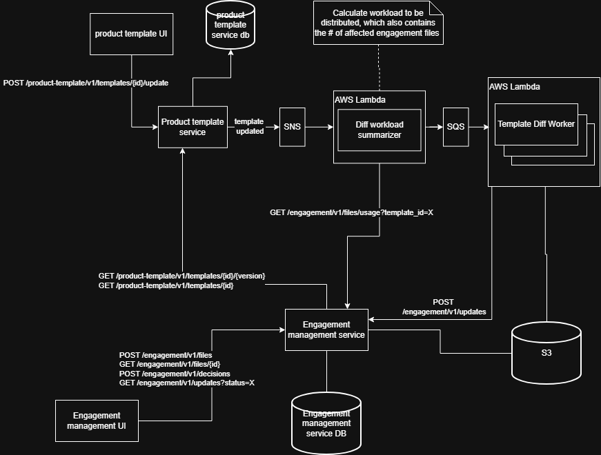
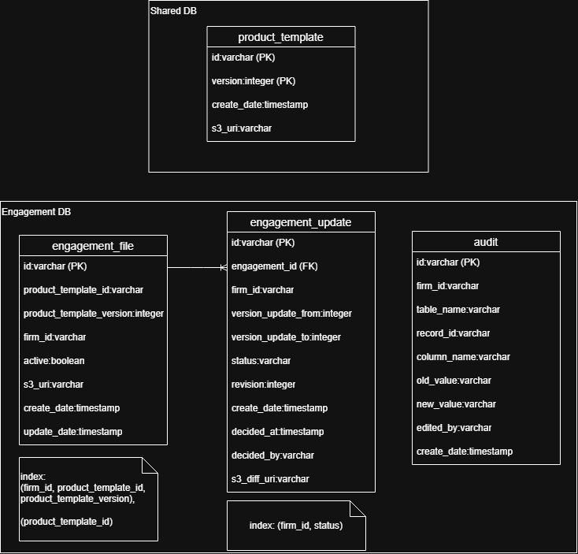

# Pending Template Update Detection: Design Draft

## Goals and key constraints

- Show, per firm, which engagements have a pending template update, plus a human-readable summary of what changed, without ever loading an engagement (~1 min each) on a user-facing path.
- The shared template DB holds no firm or engagement data and must stay that way.
- Scale: hundreds of engagements per firm, many firms, ~1 publish per product per week, but one publish can touch every firm at once.
- Out of scope: applying the update.

## 1. Target Architecture

 

  

**Components**

- **Product template service + DB (existing):** stores all versions. On publish it emits a `template.updated` event to **SNS**.
- **Diff workload summarizer (Lambda):** consumes the event and asks the engagement service which versions of that template are in use: `GET /engagement/v1/files/usage?template_id=X`. The response contains only distinct versions and counts for active engagements (no firm or engagement IDs). It enqueues one job per distinct `from` version (`from -> latest`) onto **SQS** (with a DLQ).
- **Template Diff Worker (Lambda):** fetches the two versions from the template service, computes the JSON diff with the existing comparison capability, builds a human-readable summary, and writes both to **S3** at a deterministic key (`{template}/{from}-{to}/`). It then calls `POST /engagement/v1/updates` with `(template_id, from, to, s3_diff_uri)`.
- **Engagement management service + per-firm DB:** creates or updates pending rows, serves the list and detail views, and handles decisions.

**Data model (Figure 2)**

- `engagement_file`: a fast projection of the engagement (template ID, version, firm, active flag). It is maintained by the create and decision hooks and is never read from the loaded engagement. Index: `(firm_id, product_template_id, product_template_version)`.
- `engagement_update`: one row per pending or decided update: `update_from`, `update_to`, `status` (pending, applied, declined, superseded), `revision`, `decided_at/by`, `s3_diff_uri`. Unique on `engagement_id` where `status = 'pending'`. Index: `(firm_id, status)`.
- `audit`: append-only change history, written by the engagement service.
- `product_template` is in the shared DB. The link from `engagement_file` is a logical reference (validated on write, checked by reconciliation), not a cross-DB foreign key.

**Read path:** the list view reads `engagement_update` by `(firm_id, status)` in a single query. The summary is fetched from S3 on the detail view only.

## 2. Implementation Plan

1. Engagement projection: add create and decision hooks that maintain `engagement_file`; backfill existing engagements with a one-time batch job.
2. `engagement_update` table, `POST /updates` upsert, list and decisions endpoints.
3. Usage endpoint (service-to-service auth only).
4. Summarizer Lambda, SQS and DLQ, Diff Worker, S3 layout and deterministic summarizer.
5. UI: pending badge on the list, summary view, apply/decline actions.
6. Observability and reconciliation before rollout.

**Accumulation (v2, v3 published before a decision).** Diffs are always computed endpoint to endpoint (current version to latest), never chained. `POST /updates` is a monotonic upsert: it only moves an engagement's target version forward. A newer target supersedes the open pending row and opens a new one, so each engagement has at most one pending row and the audit trail keeps the superseded one. Out-of-order or duplicate events are no-ops.

**Decisions.** `POST /decisions` carries the target version the user reviewed and the row `revision`. A stale revision is rejected and the user sees the refreshed summary. Accepting v2 while v3 arrives leaves a new pending 2 -> 3 row. Only "apply latest" is supported (templates are cumulative).

## 3. Testing Strategy

- **Unit:** summarizer determinism (same diff gives same summary), upsert monotonicity, hook correctness on `engagement_file`.
- **Contract:** usage response, `POST /updates` and event payloads between the template service, summarizer, worker and engagement service.
- **Idempotency and replay:** redeliver the same event or job N times; assert no duplicate or divergent pending rows and identical S3 output.
- **Accumulation:** publish v2 and v3 before a decision; publish during review; decline then publish again. Assert one pending row and the correct net diff.
- **Isolation:** attempt cross-firm reads and writes at the DB and IAM level and assert structural rejection, not only an application 403. Assert the usage response contains no firm or engagement identifiers.
- **Load:** a firm with ~500 engagements on one template plus many firms, one publish; assert completion within the SLA and zero engagement loads on the path.

## 4. Evaluation and Observability

- **Per-publish metrics:** engagements affected (from the usage total), jobs enqueued, jobs completed, updates upserted. Alert if affected and upserted totals diverge after the SLA.
- **Pipeline health:** DLQ depth alarm, job age, diff duration, summarizer fallback rate (unmapped template paths).
- **Reconciliation (nightly, per firm):** compare `engagement_file` versions against the latest template version and flag any active engagement that should have a pending row but doesn't. This also catches lost events and drift in the projection. It runs per firm because the shared side cannot know who is affected.
- **History:** every create, supersede, apply and decline writes an append-only audit record (actor, timestamp, from/to), so a firm's decision history is a direct query.

## 5. Failure Modes and Tradeoffs

| Risk | Handling |
|---|---|
| Badge lags the publish | Accepted (eventual consistency, seconds to minutes); observable through the metrics above |
| Lost or duplicated event | Idempotent upserts; DLQ; nightly reconciliation |
| Diff or summary job fails | Update is still detected and actionable; UI shows "summary unavailable"; retry then DLQ |
| Decision races a new publish | Revision check plus reviewed-version check; user sees the refreshed summary |
| `engagement_file` drifts from the real engagement | Hooks are the only writer; reconciliation flags mismatches |
| Cross-DB reference breaks | Template versions are immutable and never deleted; validate on write |
| Summary misleads | Deterministic transform of the JSON diff is the source of truth; any LLM text would be separate, labeled advisory, and never drives apply/decline |

**Security and isolation.** Each firm has its own DB or schema, resolved from the caller's identity, so isolation is structural rather than a `firm_id` filter. Only authorized users of a firm can list or act on its updates. The shared plane is firm-blind: S3 diffs and the template DB contain template data only, and the usage endpoint returns only versions and counts, is callable only by the summarizer's service identity, and aggregates across firms internally. Firm data stays in the firm's required region, and the audit table is append-only.

**Key tradeoffs:** The shared template store holds no firm data, so a publish is broadcast and the engagement service determines which versions are in use, returning only version numbers and counts. This costs one cross-firm query per publish, which is cheap at roughly one publish per product per week. Diffs are computed on demand from each version in use to the latest, rather than precomputing every version pair or chaining adjacent diffs, which would be wasteful and could show changes that were later reverted. Users can apply only the latest version, since templates are cumulative; this limits the cases to build and test, at the cost of not supporting staged adoption.

**Assumptions and open questions**

- Decline dismisses the current pending update; the next publish re-opens it with the net diff. Whether to highlight what is new since the decline is an open product question.
- The summarizer needs a mapping from JSON paths to the labels practitioners recognize; this must be built with the content team.
- Versions are integers that increase per template.